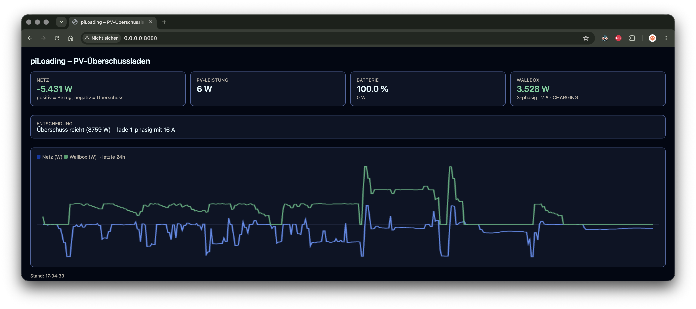

# piLoading

**🌐 English** · [Deutsch](README.de.md)

PV surplus charging for the wallbox: reads the current grid feed-in/consumption from a
**Viessmann Vitocharge VX3** (battery storage/inverter) via the Viessmann cloud API and
controls a **go-e Wallbox** through its local network API so the car is charged as much as
possible from PV surplus instead of grid power. Runs unchanged on a Mac (development, with
simulated hardware) and on a Raspberry Pi (real hardware).

## Screenshot

Web dashboard (mock mode, `PILOADING_DRY_RUN=true`, at `http://localhost:8080/`):



> **⚠️ Disclaimer – use at your own risk**
>
> This project controls **real hardware** (wallbox, charging, battery). It is provided
> **without any warranty** („as is"). Use it **entirely at your own risk**. The author
> accepts **no liability whatsoever** for damage to the charger, wallbox, battery, vehicle
> or home battery, or any other hardware or equipment that arises directly or indirectly
> from the use, configuration or malfunction of this software — including excessive wear
> or damage to the battery as well as faulty charging. Carefully check your installation
> and test with `PILOADING_DRY_RUN=true` first before controlling the wallbox in live mode.

## Requirements

- Python 3.11+
- A go-e Wallbox on the local network (known IP address or hostname)
- A Viessmann Vitocharge VX3 with access to the [Viessmann Developer
  Portal](https://developer.viessmann-climatesolutions.com/)
- For live operation: a registered client in the Developer Portal with
  `http://localhost:4200/callback` as the allowed redirect URI

## Installation

```bash
python3 -m venv .venv
source .venv/bin/activate
pip install -e ".[dev]"
```

## Configuration

```bash
cp .env.example .env
```

Then adapt `.env`. The most important variables (all prefixed with `PILOADING_`, see
`.env.example` for the full list with comments):

- `PILOADING_MODE` — `mock` (simulated day, no real hardware needed) or `live`
- `PILOADING_DRY_RUN` — `true`: reads real data and logs decisions, but never writes to the
  wallbox. Recommended before the first real live run.
- `PILOADING_GOE_HOST` — IP/hostname of the wallbox on the LAN
- `PILOADING_VIESSMANN_CLIENT_ID` — client ID from the Developer Portal (live only)

## Mock mode (development/test without hardware)

```bash
piloading run
```

Defaults to `PILOADING_MODE=mock`. Simulates a complete solar day (sunrise, PV curve,
battery charging, sunset) in accelerated time. Dashboard at `http://localhost:8080/`.

## Setting up the Viessmann login (once, for live operation)

On a machine with a browser (usually the Mac, not the Pi):

```bash
piloading auth-viessmann
```

Runs the OAuth2/PKCE login flow: a browser URL is printed, and after logging in in the
browser the callback is intercepted locally. The plant/gateway/device are then auto-detected
(interactively queried if there are multiple matches) and the credentials including the
refresh token are written to `~/.config/piloading/viessmann_auth.json` (chmod 600).

For the Pi: after setting up on the Mac, copy this file to the Pi — `auth-viessmann` never
has to run on the Pi itself:

```bash
scp -r ~/.config/piloading pi@<pi-host>:~/.config/piloading
```

## Live operation

```bash
PILOADING_MODE=live PILOADING_DRY_RUN=true piloading run
```

First check with `dry_run=true` that the grid/PV/battery values and the logged decisions
look plausible. Then set `PILOADING_DRY_RUN=false` to actually control the wallbox.

**Note on the sign of the grid power:** if `grid_power_w` is shown as negative (instead of
positive) in the dashboard when importing from the grid (or vice versa), toggle
`PILOADING_INVERT_GRID_POWER_SIGN`.

## Deployment on the Raspberry Pi

```bash
sudo cp deploy/piloading.service /etc/systemd/system/
sudo cp .env /etc/piloading.env   # PILOADING_MODE=live, PILOADING_DRY_RUN=false
sudo systemctl daemon-reload
sudo systemctl enable --now piloading
journalctl -u piloading -f
```

`Restart=on-failure` makes the service restart automatically after a crash.

## Tests

```bash
pytest
```

## Known uncertainties

- The go-e key `psm` (phase switching) is not officially documented but comes from
  community reverse engineering. It is only sent on an actual phase change, not in every
  cycle.
- A phase change physically toggles the contactor and can presumably make go-e briefly
  report `car_state=COMPLETE` even though the car is still charging — the cause of a real
  incident in which piLoading, directly after a 1->3-phase switch, wrongly treated an
  in-progress (not full) charge as finished. piLoading therefore ignores `COMPLETE` for
  `PILOADING_PHASE_SWITCH_SETTLE_S` (default 15s) after a phase change of its own.
- The Viessmann feature names for PV power and battery (`photovoltaic.*`, `ess.*`) are
  plausible assumptions but not officially confirmed for the VX3 — only the grid feature
  `pcc.transfer.power.exchange` is cross-checked against an independent source. On first
  start in live mode, the complete list of discovered features is logged once; if PV/battery
  stay empty in the dashboard, search there for the actual names and adjust
  `clients/viessmann.py` accordingly.
- The rate limits of the Viessmann API are not exactly known. While a car is connected, it
  is queried once per `PILOADING_CONTROL_INTERVAL_S` (default 10s); if no car is connected
  or the charge is already finished, the Viessmann query pauses completely and only go-e is
  polled (more slowly, every `PILOADING_GOE_POLL_INTERVAL_S`, default 60s) for a newly
  plugged-in car.
- **Night mode:** if a car stays plugged in without sufficient surplus (e.g. after sunset)
  for `PILOADING_NIGHT_MODE_AFTER_S` (default 600s), the control loop switches to the slower
  `PILOADING_NIGHT_MODE_POLL_INTERVAL_S` (default 600s) for *both* queries (Viessmann and
  go-e) so the daily request limit is not exhausted overnight. As soon as sufficient
  surplus is measured again, the loop immediately switches back to
  `PILOADING_CONTROL_INTERVAL_S` and resumes charging (after `PILOADING_START_DELAY_S`
  elapses). Night mode is shown in the dashboard with a banner.
